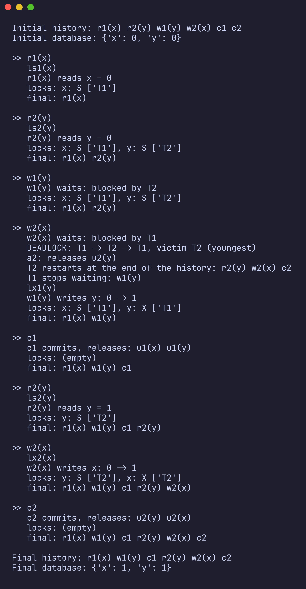
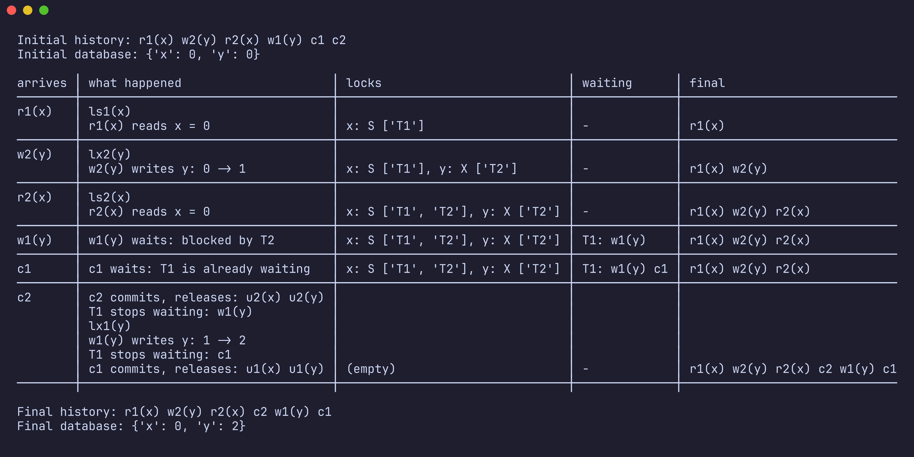

# 2PL Scheduler Simulator

A small Python program that simulates how a database decides the order in which transactions run, using Strict Two-Phase Locking (Strict 2PL).

I built it for the Databases course at UCS (Universidade de Caxias do Sul) and later rewrote it in English.


## The idea

When several transactions use the same data at the same time, the database can't just run their operations in the order they arrive. Two transactions writing the same value, or one reading something the other hasn't finished writing, would leave the data in a broken state.

Strict 2PL solves this with locks. Before reading a value, a transaction needs a shared lock on it. Before writing, it needs an exclusive lock. Many transactions can share a read lock, but a write lock belongs to only one. If the lock isn't available, the transaction waits. Locks are only released when the transaction commits (or is aborted), so nobody ever sees a value that could still be undone.

The simulator takes a list of operations in the order they arrive (the initial history) and shows, step by step, the order in which they really run (the final history).

```
initial:  r1(x) w2(y) r2(x) w1(y) c1 c2
final:    r1(x) w2(y) r2(x) c2 w1(y) c1
```

Here `w1(y)` has to wait because T2 is holding a write lock on `y`, and `c1` waits behind it. Once `c2` arrives, T2 releases its locks and T1 can finish.

## Rules the simulator follows

- `r` (read) asks for a shared lock, `w` (write) asks for an exclusive one.
- Shared locks can be held by many transactions at once. Any other combination blocks.
- A transaction never blocks itself. If it is the only one reading a value and then wants to write it, its lock is upgraded.
- When a transaction has to wait, it stops completely. Its next operations line up behind the blocked one.
- Locks are released only on commit or abort.

For every operation that arrives, the simulator tries to run it (or makes it wait), then checks if anyone who was waiting can continue, and then checks for deadlock.

## Deadlocks

A deadlock happens when transactions wait for each other in a circle, for example T1 waits for T2 and T2 waits for T1. Neither can ever continue.

To find them, the simulator builds a wait-for graph after each operation, where an edge from T1 to T2 means "T1 is waiting for a lock T2 holds", and searches it for a cycle using depth-first search.

When it finds one, it aborts the youngest transaction in the cycle (the one with the highest number). Aborting means undoing its writes, removing its operations from the final history, releasing its locks and sending all of its operations back to the end of the queue, so it runs again later.



## Running it

You need Python 3.10 or newer. There are no dependencies.

```
python3 main.py "r1(x) w2(y) r2(x) w1(y) c1 c2"
python3 main.py examples/simple_deadlock.txt
python3 main.py --table examples/no_conflict.txt
```

The input is a list of operations separated by spaces. `r1(x)` means transaction 1 reads `x`, `w2(y)` means transaction 2 writes `y`, and `c1` means transaction 1 commits. You can type it directly or point to a text file. The `examples` folder has a few ready to use, including a deadlock between three transactions.

In the output, `ls1(x)` is a shared lock, `lx1(x)` an exclusive lock, `u1(x)` an unlock and `a2` means transaction 2 was aborted.

The data is kept in memory. Every value starts at 0 and each write adds 1, which makes it easy to see whether a write happened or was undone.

With `--table`, the steps are shown side by side with the lock table, the waiting queue and the final history:



To run the tests:

```
python3 -m unittest
```

## Code

```
main.py                   reads the input and prints the result
scheduler/history.py      parses operations like r1(x)
scheduler/database.py     the in-memory data
scheduler/locks.py        lock table: who holds what, who is blocked
scheduler/scheduler.py    main loop, waiting queues, abort and undo
scheduler/deadlock.py     wait-for graph and cycle search
scheduler/step_table.py   the --table output
```

## What it doesn't do

- Transactions can't abort on their own, only because of a deadlock.
- There's no protection against starvation. Since the victim is always the youngest, the same transaction can be aborted more than once.
- Waiting isn't first come, first served. A transaction waiting to write can be passed by readers that arrived after it. In `r1(x) w2(x) r3(x) c1 c2 c3`, `r3(x)` runs before `w2(x)`.

## License

MIT
